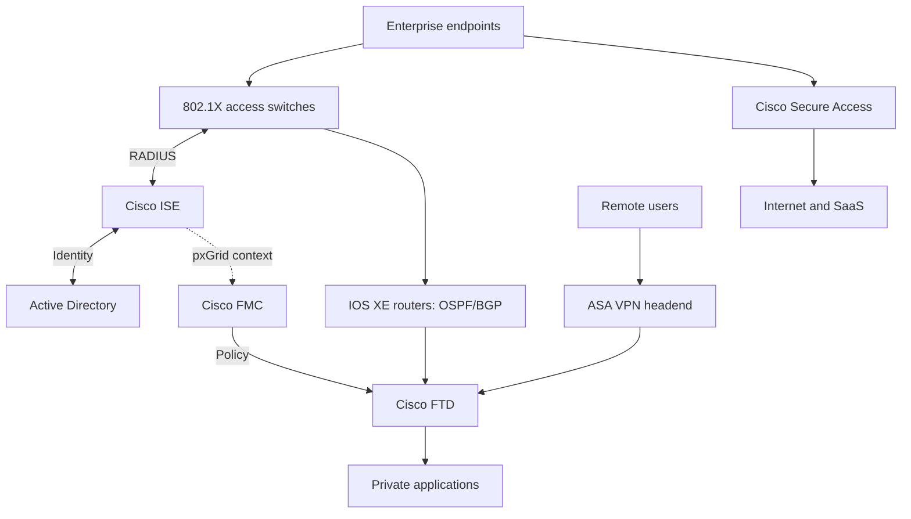

# Cisco Zero Trust Security Fabric

**Enterprise reference architecture** — Cisco Secure Access (SSE/SASE), Cisco FTD/FMC, ASA VPN, IOS XE routing, Microsoft Active Directory, and Cisco ISE with 802.1X, pxGrid, and TrustSec.

> Reference design only. Configuration examples require platform/version-specific review and lab testing before deployment. No real IP addresses, credentials, or production customer details are included.

## Executive summary

This blueprint illustrates how enterprise identity and device posture can inform access controls across wired access, VPN, routed segments, internal firewalls, and SaaS/private applications. It separates policy intent, control-plane integrations, and enforcement points, with explicit rollback and validation gates.

## Topology

## Architectural pillars

| Domain | Design |
| --- | --- |
| Identity | AD as identity source; Cisco ISE authorization by identity, posture and endpoint context |
| Campus | 802.1X/RADIUS access control, SGT classification, TrustSec propagation only where supported |
| Network core | OSPF internally and controlled BGP peering at explicit boundaries |
| Segmentation | FMC-managed FTD access policies plus TrustSec/SGT where supported |
| Remote access | ASA VPN headend terminates remote access into a restricted zone |
| SSE/SASE | Cisco Secure Access provides policy-based SaaS/web/private-app access |
| Observability | Centralized authentication, policy hit, firewall, routing and incident telemetry |

## Security design principles

1. Default-deny cross-zone traffic after documenting required application dependencies.
2. Separate management, user, server, identity and guest networks.
3. Use ISE authorization decisions with explicit fallback behavior and change control.
4. Keep remote VPN clients in a constrained landing zone, never an unrestricted trusted LAN.
5. Treat pxGrid as a context exchange, not an enforcement point.
6. Validate software release, license, API support and hardware capability before using TrustSec or device-specific CLI.

## Segmentation example

| Source | Destination | Service | Action |
| --- | --- | --- | --- |
| Managed employees | Approved application | TCP 443 | Allow after identity/policy checks |
| Application tier | Database tier | TCP 5432 | Allow only from approved workloads |
| VPN landing zone | Admin jump host | Approved management ports | Allow with MFA |
| Guest / unmanaged | Internal production | Any | Deny |
| User endpoint | Database | Any | Deny |
| All other interzone flows | Any | Any | Deny, with logging |

## Validation and implementation

Follow an approval-gated rollout: inventory endpoints and dependencies; stage ISE policy in monitor mode; validate RADIUS and fallback; deploy FMC rules with logging; validate VPN restrictions and Secure Access posture; measure routing stability; and run rollback drills.

**Author:** Darian O'Dirling · [Portfolio](https://darianodirling.github.io/) · [GitHub](https://github.com/darianodirling)
