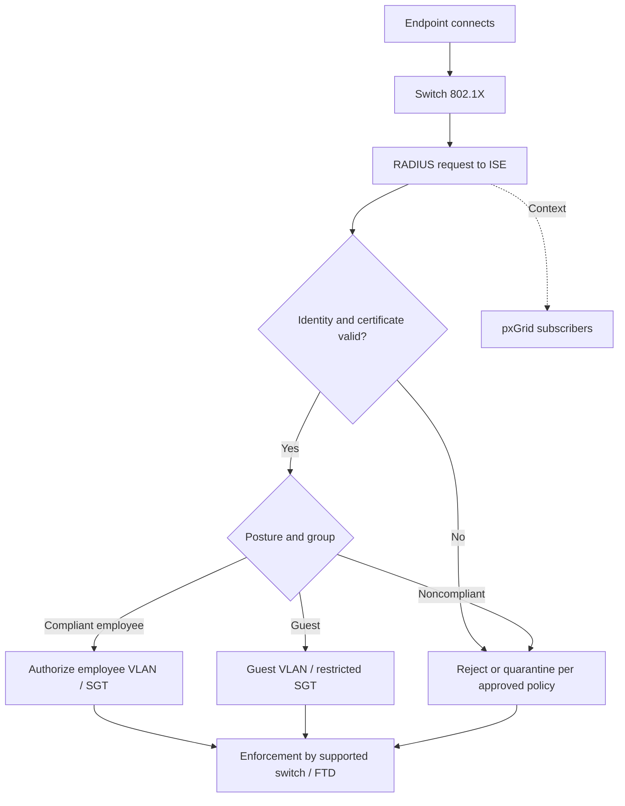

# Cisco ISE policy flow

**Checks:** EAP-TLS trust chain, RADIUS reachability, device time, AD group lookup, CoA, certificate renewal, ISE node failure, authentication bypass exceptions and audit logs.
